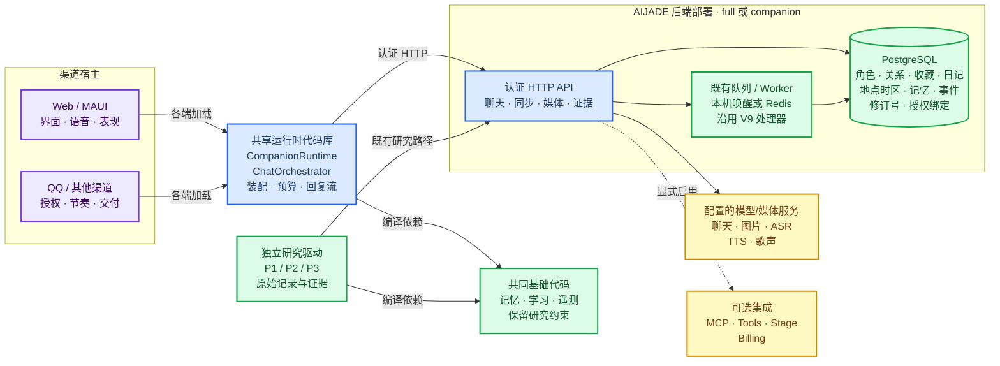
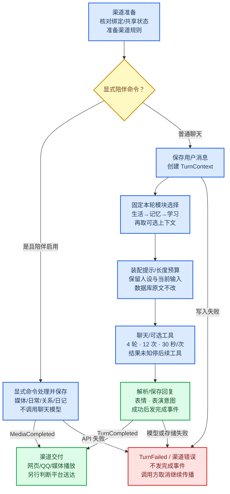

# AIJADE 陪伴运行架构

AIJADE 优先开发持续交互的情感陪伴。MOSAIC 的连接组研究和具身智能保持独立，两个项目按明确接口借鉴产品能力。本页描述本轮重构后已有的代码与运行关系；30 个陪伴项目和 3 个架构主参考见 [参考目录](COMPANION-REFERENCES.md)，它们的能力不计入 AIJADE 的完成状态。

## 🧭 系统总览

图中的 `CompanionRuntime` 是各宿主进程内复用的 **.NET 代码库**，不是新增的中央 Agent 服务器。实线表示已有调用/依赖，虚线表示需配置启用的可选集成。模型、图像、语音和 MOSAIC 舞台是否可用，取决于相应服务及授权资产；图中有适配入口不代表服务已经接通。

<!-- architecture:overview -->


可直接查看[总览 PNG](architecture/overview.png) 或[矢量 SVG](architecture/overview.svg)。本页 Mermaid 是可编辑的唯一源稿，图片由 [渲染脚本](../tools/render-architecture.py)提取生成；未依赖 GitHub 的 Mermaid 版本。

Web、MAUI、QQ 按渠道能力装配。MCP 的普通聊天工具也复用此库，当前只装配记忆与普通聊天，并未获得 Web/QQ 的身份绑定和媒体交付能力。客户端的天气适配器在用户配置地点并开启后直接读取 Open-Meteo，不经过模型网关；未启用或读取失败时不假造实时天气。

后端部署区内的 PostgreSQL 是独立数据库组件；API 与 worker 根据 `Aijade:Role` 同进程或分离部署。图中的组合区域不表示它们是同一个进程。

## 🔄 单轮消息与结果交付

<!-- architecture:turn-flow -->


可直接查看[流程 PNG](architecture/turn-flow.png) 或[矢量 SVG](architecture/turn-flow.svg)。主动消息和到期提醒走原有门控，再共用回复解析与保存；它们跳过普通记忆召回与学习观察者，只可带产品生活上下文，不冒充一条用户输入，也不转入外部工具循环。

## 🧩 代码职责与状态所有权

| 代码或数据 | 负责内容与边界 |
|---|---|
| [CompanionRuntime / ChatModuleSet](../src/Aijade.Client/Chat/CompanionRuntime.cs) | 一张有序清单同时装配上下文和观察者；每个 `TurnContext` 的模块选择只确定一次，开关影响下一轮。可选模块故障独立降级，调用方取消保留。缓存以弱引用关联回合，不启动清理循环 |
| [ChatOrchestrator](../src/Aijade.Client/Chat/Orchestrator.cs) | 保存用户消息、提示装配与模型调用；普通聊天、主动消息、提醒共用回复解析/存储/意图构建。写入失败发出 `TurnFailed` |
| [PromptBudget](../src/Aijade.Client/Chat/PromptBudget.cs) | 产品附加上下文、历史与工具结果长度限制。截断有标记，不切开 UTF-16 代理对；优先保留近期历史，不改数据库中的原文 |
| [CompanionMediaTurn](../src/Aijade.Client/Companion/CompanionMediaTurn.cs) | `/photo`、`/sing`、`/life`、`/relationship`、`/diary` 显式入口；保存结果后产生 `MediaCompleted`，图片/歌声可能调用已配置的专用服务，日记不调用模型 |
| [ToolConversation](../src/Aijade.Client/Chat/ToolConversation.cs) | 有界的按需工具执行，工具须在本轮清单内，参数须为 JSON 编码对象。零轮数/零调用数不探测工具，直接走流式聊天 |
| `CompanionSyncStore` / PostgreSQL | 账户/角色、地点时区、关系与收藏的权威状态；修订号、并发冲突检查、可撤销 QQ 授权。日记使用同一权限边界下独立、按需读取的文档，不进入普通状态载荷 |
| `ServerModules` / `CompanionWorker` | 启动时组合可选集成；精简配置且无 Redis 时排空既有队列，再等待合并唤醒。沿用 `V9Worker.DrainOnceAsync`，不新增调度平台 |
| `Aijade.Bots` / 渠道连接器 | 授权、会话映射、单会话串行、消息节奏与平台交付。网页 localStorage 的提醒与机器人文件中的提醒仍是各自渠道状态，没有宣称统一同步 |

公共消息、HTTP/OneBot/SignalR/渲染协议、表结构及研究驱动继续保留。新增预算是产品类，不是新进程或新 .NET 项目；本轮未增加 NuGet 包。MOSAIC 只通过已有舞台/渲染接口作为可选产品适配，不把连接组研究放入 AIJADE 的聊天主循环。

## ⚙️ 有界执行与可修改配置

| 项目 | 产品默认值 | 生效与含义 |
|---|---:|---|
| 单模块上下文 | 4,000 字符 | 按装配顺序取用，超出时带截断标记 |
| 附加上下文合计 | 12,000 字符 | 包含模块间分隔符；预算用完后不再请求后续上下文 |
| 历史 | 最近 24 条内最多 24,000 字符 | 从最近消息向前保留整条；仅当最新一条本身超长时保留有标记的片段 |
| 单个工具结果 | 8,000 字符 | 普通结果超长时截断；不把结果未知的关键说明裁掉 |
| 工具轮数 / 外部调用数 | 4 / 12 | 各自钳制为 0–16 / 0–64；任一为零不请求工具清单 |
| 单次工具期限 | 30 秒 | 钳制为 1–300 秒；取消等待不等于远端撤销动作 |

以上长度按 UTF-16 字符计，**不是 token 容量保证或新的速度测量**；人设、当前输入、渠道规则和工具定义不在附加上下文预算内。小于截断标记的可用空间直接省略该片段，不产生无提示的残缺断言。较低预算会改变产品提示内容，实际模型仍须按其上下文窗口和输出预算配置。

超时、网络中断、HTTP 408/5xx 或不可解析回执会向模型交还“结果未知”的说明，并禁止本轮后续工具与自动重试。已生效的远端动作可能继续存在；这是执行边界，不是事务回滚或跨崩溃 exactly-once。模型能否准确复述错误仍需真实模型验收，工程测试不替代它。

Web/MAUI 的导出设置支持 `promptBudget` 和 `toolTimeoutSeconds`，导入保存后下一轮使用；原有界面无须增加技术配置页。QQ 宿主支持 `Bridge:ToolTimeoutSeconds`、`Bridge:PromptBudget:ModuleCharacters`、`SupplementCharacters`、`HistoryCharacters` 和 `ToolResultCharacters`。环境变量将 `:` 替换为 `__`。

QQ 的这些运行参数在 `Aijade.Bots` 启动时读取，修改环境变量后重启机器人宿主；共享的角色与生活状态仍在下一轮从服务端读取。

```json
{
  "promptBudget": {
    "moduleCharacters": 4000,
    "supplementCharacters": 12000,
    "historyCharacters": 24000,
    "toolResultCharacters": 8000
  },
  "toolTimeoutSeconds": 30
}
```

此片段合并到现有导出文件的 `settings` 中，保持外层 `format: aijade.export.v1`。长度配置分别钳制到 0–128,000。预算没有被加入跨端共享角色状态，Web 本地设置和机器人部署参数仍可按渠道能力不同；已统一同步的角色、地点时区、关系与收藏保持原生效规则。

## 🚀 运行配置与功能边界

| 配置 | `full`（原有默认） | `companion`（显式选择） |
|---|---|---|
| 核心 API、聊天、角色/关系/收藏同步、记忆与证据管线 | 保留 | 保留 |
| MCP、外部工具、MOSAIC 舞台桥、Stripe | 默认挂载 | 默认不挂载，可逐项开启 |
| 单进程无 Redis 的后台队列 | 原 worker 时序 | 同一处理器，有任务唤醒 |
| Redis 分离 API/worker | 原路径 | 原路径 |

```bash
# 先配置现有 DATABASE_URL、模型网关与账户
tools/run-companion.sh

# 按需开启原有工具与 MCP
tools/run-companion.sh --Aijade:Modules:Tools=true --Aijade:Modules:Mcp=true
```

配置通过 `Aijade__Profile=companion`、`Aijade__Modules__Tools=true` 等环境变量也可设置。角色仍有 `api`、`worker`、`all`；模块组合启动后修改需重启。认证后的 `GET /api/v1/runtime` 返回实际 profile、角色、队列方式与集成开关。错误模块名、未知 profile、非法布尔值在启动时报错；未挂载的 API 返回 404。

| 功能状态 | 内容 |
|---|---|
| 已有并继续复用 | 共享角色/地点时区/关系/收藏、普通聊天、主动消息门控、虚拟日常、表情与节奏、照片/语音/唱歌的可配置入口；稳定单轮模块清单、上下文与工具预算 |
| 当前追加 | 手动保存有来源的日记摘录、全原文哈希和修订控制、Web/QQ 共享读取、注入时钟的跨时区修复；产品提示明确要求可见正文，纯表情回复仍按空回复失败处理 |
| 配置后仍需实测 | 真实 QQ 收发、天气联网、图像服务、本地授权音色/歌声、MOSAIC/MMD 舞台与外部工具设备 |
| 后续独立扩展 | 自动生成且保留历史版本的日记、持久生活任务与平台交付 outbox、多角色社交；当前未实现，不画成已部署模块 |

## 🧪 验证与研究兼容

工程测试覆盖模块切换、故障/取消、截断后的提示与原始存储、旧直接构造入口、无效工具参数、超时/断网/5xx、零预算，并回归完整聊天与同步流程。最新[共同日记回执](../experiments/engineering/2026-11-10-shared-diary/receipt.json)补充来源校验、跨端摘录、修订冲突、时区注入修复与本地模型检查；本地模型的标记空回复、冷加载超时和就绪后通过分别保留。实际命令、计数、跳过项、日志哈希、源码哈希和保护清单在各轮回执中列明，上一轮[架构回执](../experiments/engineering/2026-11-10-life-architecture/receipt.json)与此前[重构回执](../experiments/engineering/2026-11-10-runtime-refactor/receipt.json)继续保留。

研究/共同基础的既有文件以及声明的研究对象按基线逐字节核对。直接 `new ChatOrchestrator(...)` 且未显式设置 `PromptBudget` 的旧驱动保留原提示长度策略；产品工厂采用新预算，因此 **冻结记忆文件未改不等于产品提示与原实验完全一致**。后续基于产品传递路径的测量须记录新策略和配置，已有论文结果不重写、不据工程 PASS 提升研究结论。

内存队列仍会随进程结束而丢失；持久分离部署继续配置 Redis。没有引入 Cordis 热安装、Comma 式任务验收平台、跨进程工具动作事务 outbox、自动平台登录/发帖或自动人格改写。本轮也没有运行新训练、正式研究实验或论文投稿。
