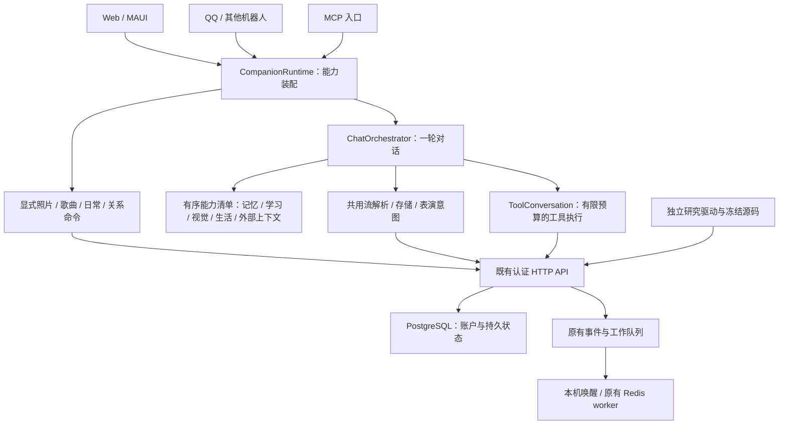

# AIJADE 运行架构与参考项目

AIJADE 的主线是持续交互的情感陪伴。Web、MAUI、QQ 与其他聊天渠道使用共享 .NET 运行时；服务端保存账户、角色选择、地点时区、关系与收藏。研究工具、实验数据和测量源码继续独立保留。本文描述实际实现，参考项目的功能不计入 AIJADE 的完成状态。

## 参考检索与取舍

2026-11-10 使用 Agent Reach 的 Exa、B 站 CLI、GitHub 连接器和网页阅读检索“蓝色大肥鱼”“给大肥鱼完整的一生”“养鱼”，并核对以下来源。固定提交、许可证、读取范围和未确认来源见 [references.json](../experiments/engineering/2026-11-10-runtime-refactor/references.json)。这些项目没有被安装或运行，第三方源码没有并入本次实现。

| 来源 | 核对到的内容与采用方式 |
|---|---|
| [DeepSeek Harness](https://github.com/deepseek-ai/deepseek-harness/tree/fcc0ad462172522aaf5c93a7b2e01f6b9f0b0159) · MIT | 官方架构说明 Cordis 服务、事件、效果与 profile/bundle 组合。采用显式能力装配，继续使用现有 .NET 宿主和协议 |
| [dsh-superagent-prototype](https://github.com/deepseek-ai/dsh-superagent-prototype/tree/8c32a9dc5d72c033816c6a8110b37f40cf94fba4) · MIT | 作者标注为研究原型。Runtime 负责组合与生命周期，Engine 管状态，适配器执行外部效果。采用职责分离和有限预算的工具执行 |
| [Comma](https://github.com/AFK-surf/Comma/tree/66ab3dc92475005aea9afd123df36a28e4ef86ab) · AGPL-3.0-only | 持续任务与会话界面分离、程序化 Loop 按需唤醒、单写者契约。参考状态所有权和唤醒思想；未移植其代码或引入其 Elixir/Lean、Redis、MinIO、ClickHouse 服务栈 |
| [多数字生命实验](https://github.com/nefelibata5136-code/deepseek-harness-digital-life/tree/6c81c913fd837662b001f1fb88d59d78eb3d2164) · MIT | [作者原视频](https://www.bilibili.com/video/BV1VAnB6EESr/)简介明确链接该仓库。参考持续身份、私有空间、通信与记忆的划分；多角色社会、独立创作与跨 Agent 通信未接入 |
| [dsh-yangyu](https://github.com/YKY0521/dsh-yangyu/tree/8d58e7c3aeb68d2b46f1d913f4891c388da65923) · MIT | README 与 runtime 体现角色绑定和上下文隔离。保留已有账户/角色隔离、显式 QQ 授权和下轮读取生效规则 |
| [dsh-bili-whale](https://github.com/Alterssss/dsh-bili-whale/tree/8b0009f8ce2ebdc421afcb2e727b19ac18912ec6) · MIT | scheduler 使用生物钟、持久计划和预算。参考先用规则判断再唤醒；本次未增加自主刷 B 站、评论、私信或平台登录 |
| [AuraLife](https://github.com/hsushjk/dsh-auralife/tree/64554d4cafbfb4322d4e6316390474799a268eab) · MIT | README 描述模块化多模态、人格与记忆生命周期。作为功能参考；激素模型、自写器官和自修改能力未移植，也未独立验证 |
| [AstrBot](https://github.com/AstrBotDevs/AstrBot/tree/6b10af75e118714335aff3aab047bf7689fa1388)、[NapCatQQ](https://github.com/NapNeko/NapCatQQ/tree/98d781d19815d1625b24d717ce280ecf0a4f6d0c)、[鲸鱼娘人设插件](https://github.com/Kaalia0912/dsh-whale-musume-persona/tree/0fbdcf217e3bf94e35fef36f7ac56134b704529b) | 本次仅核对仓库元数据，作为 QQ 生态补充入口。继续使用已实现的 OneBot 11 适配 |

“superagent”在本次比较中指 DeepSeek 官方组织的 `dsh-superagent-prototype`，与其他同名 HTTP 库和安全产品分开。FullLife 作者文章可读，但未从该文章确认源码链接；也未确认此前 Vespera／Whisper洗碗视频的作者绑定仓库。它们不作为已验证的开源实现。

## 实现与数据所有权



渠道共享运行时，按各自能力装配。浏览器提供视觉、浏览器/IDE 上下文与本地学习；机器人按平台决定音频、图片、提醒的交付。MCP 当前装配记忆与普通聊天，没有自动获得 Web/QQ 的绑定或媒体交付能力。

| 所有者 | 负责的行为 |
|---|---|
| `CompanionRuntime` / `ChatModuleSet` | 一张有序清单同时装配上下文和观察者。模块有名称和开关；可选模块故障独立降级并记录名称/异常类型，调用方取消继续向上传递 |
| `ChatOrchestrator` | 保存用户消息、装配提示、调用模型；聊天、主动消息、提醒共用回复流、存储与意图构建。写入失败产生 `TurnFailed`，不产生 `TurnCompleted` |
| `CompanionMediaTurn` | 共享入口分流 `/photo`、`/sing`、`/life`、`/relationship`；结果保存后产生 `MediaCompleted`，渠道负责交付。显式生活/关系命令不调用聊天模型 |
| `ToolConversation` | 只在工具开关打开的一轮中工作。默认最多 4 轮、12 次外部调用；参数必须是 JSON 对象，工具必须属于本轮提供的清单，预算耗尽时交还错误结果。不自动重放外部动作 |
| `CompanionSyncStore` / PostgreSQL | 角色、地点时区、关系与收藏的权威来源；保留修订号、并发冲突检查与可撤销 QQ 绑定。客户端下轮重新读取 |
| `ServerModules` | 选中的集成服务注册、端点挂载与启动检查；未启用的集成不建立对应服务或探测地址 |
| `CompanionWorker` | 在 `companion` 且无 Redis 的后台角色中，先排空队列，再等待合并的唤醒提示；仍调用原有 `V9Worker.DrainOnceAsync` 处理任务 |

公开类型、消息协议、原有路由、表结构与研究驱动保留。`ChatContracts`、`ChatPresentation`、`RenderReporter` 从大文件分出，它们不是新的进程、服务或项目。本次没有增加 NuGet 依赖或 .NET 项目。

## 运行配置

两种 profile 共用聊天、账户、同步、媒体服务入口、长期记忆与事件证据管线。记忆同步 outbox 仍需后台处理，因此保留该管线。

| 配置 | `full` | `companion` |
|---|---|---|
| 默认与选择方式 | 未显式指定时保持原部署默认 | 通过脚本或配置显式选择 |
| 核心 API、角色/关系/收藏同步、长期记忆 | 保留 | 保留 |
| MCP、外部工具、MOSAIC 舞台桥、Stripe 端点 | 启用 | 默认不挂载，可以逐项打开 |
| 单进程无 Redis 的后台队列 | 原 worker 时序 | 同一处理器，有任务时唤醒 |
| Redis 分离 API/worker | 原路径 | 原路径 |

```bash
# 先配置现有 DATABASE_URL、模型网关和账户。
tools/run-companion.sh

# 按需打开工具与 MCP。
tools/run-companion.sh --Aijade:Modules:Tools=true --Aijade:Modules:Mcp=true

# 原有部署与研究驱动默认 full；也可以显式指定。
dotnet run --project src/Aijade.Server -- --Aijade:Profile=full
```

环境变量使用 `Aijade__Profile=companion`、`Aijade__Modules__Tools=true` 等形式。`Aijade:Role` 保留 `api`、`worker`、`all`。服务端 profile/模块在启动时组合，修改后需重启；角色、地点时区、关系、收藏和客户端模块开关仍按保存/下轮读取规则生效。未知 profile、拼错的模块名和非布尔值会在启动时报错。

认证后的 `GET /api/v1/runtime` 返回实际 profile、角色、队列方式和集成开关。未挂载的 `/api/…` 路径返回 API 404，避免被网页入口返回 HTML。QQ 继续通过独立的 `Aijade.Bots` 宿主和 NapCat/OneBot 接入；`Bridge:Model`、`Bridge:MaxToolRounds`、`Bridge:MaxToolCalls` 可以配置模型和单轮预算。同步配置见 [COMPANION.md](COMPANION.md)。

## 验证与边界

本次覆盖正常聊天、主动消息、提醒、媒体命令、模块故障/取消、工具总预算与无效参数、运行配置、队列唤醒和记忆 outbox，并运行原有单元/集成及浏览器测试。[工程证据](../experiments/engineering/2026-11-10-runtime-refactor/)记录实际结果与源码哈希。研究冻结文件、已有原始实验记录及计划与重构前逐字节核对；工程 PASS 不增加论文研究结论。

本次没有实现 Comma 式持久任务/人工验收面板、跨进程工具动作的事务 outbox 或 Cordis 插件热安装。外部动作仍不具备跨崩溃的 exactly-once 保证；内存队列仍随进程结束消失，需要持久队列时继续配置 Redis。真实 QQ 账号、Windows MMD 舞台、本地授权音色和自主平台活动保留各自环境的验收要求。
