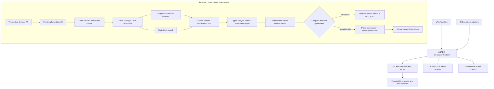

# Prefix processing and the Mac backend gate — 17 November 2026

AIJADE's companion product and its research apparatus retain separate acceptance
boundaries. The seven product responsibilities remain identity, memory, life,
perception, planning, execution and delivery. This update changes the research
apparatus and its evidence; it does not establish live QQ delivery, independent
human judgments, hardware certification, or a product-wide scientific result.

The diagram shows architectural responsibilities and the observed contention
point. It does not imply that the block or heldout branches executed. The actual
P4 attempt was refused before spawning block 1; no block model request occurred.

## Implemented and verified engineering change

The lifecycle producer and separate online readers use incremental parsing and
rolling SHA state. Readers still read and compare the entire previously accepted
prefix on every call. They retain detached snapshots, reject rewritten prefixes,
and keep the cold replay auditor as the independent oracle. No cached PASS is
used. Binary authentication likewise reads complete file content on every
observation; retained approved bytes avoid repeated parsing/hash setup without
substituting timestamps for content. Original byte and memory limits apply.

Engineering attempt 01 remains refused: ten raw PASS observations yielded nine
complete-service acceptances, with the tenth service exceeding two seconds.
Attempt 02 completed all 362 planned observations, 1,478 finite tasks with actual
parent-waited zero exits, and complete independent cold replay. Its maximum full
service was 1.888433607 seconds. This establishes the frozen single-controller
engineering workload, including its original helpers, journal and service costs.
It does not cover the later sequence/block nested-observer concurrency. The
reported small concurrent review/report write remains disclosed; no causal
single-component speedup or fully idle host is claimed.

## Actual scientific qualification outcome

The separately published P4 plan, Q `147564c9db812c1a9e5ae07992d9aa282399a310`,
and B4 `8acfa99d061f1c41197fac2a1c243b3b347bcfef` were fixed before execution.
All 300 settling and 60 admission observations were validated and the preflight
was admitted. On entry to runtime, the first sequence observation overlapped
block-1 launch. The shared capture lock exceeded the launcher's 1.25-second wait
budget. The launch record has no spawned PID, lease or readiness bytes. The
controller stopped with exit 1, zero completed conditions, and all 20 known
conditions unattempted. The adverse journal status remains refused even though
the registry lists no remaining child identity; generic error prose is not
evidence that an unspawned child existed.

The authoritative machine summary, original bytes, time measurements, source
identities and independent audit are in
`../experiments/ch7/mac-prefix-v4-2026-11-17/qualification-attempt-01/packet/`.
No seed or fresh heldout case was constructed. Table 7.3 remains `NOT_RUN`.

## Required next research step

Keep this one-shot refusal immutable. Diagnose both the initial launch race and
the sustained contention between sequence and block observers. A fixture-only
candidate or a rearranged first launch cannot establish schedulability of the
complete nested workload. Preserve the 1.25-second lock wait, 2.5-second capture,
three-second coverage gap, exact content reads, ownership proof and real waits.
Before any further live attempt, publish a separate prospective decision with a
fixed source/build, explicit nested-load population and adverse dispositions.
Only its complete accepted qualification and a subsequent public construction
freeze may precede the already confirmed forty-pair comparison.

The journal manuscripts and dissertation report engineering acceptance and
scientific refusal separately. CAS category 2 or above remains a publication
target. Research sufficiency, human verification, official journal category and
author/supervisor submission approval retain their own evidence requirements.
