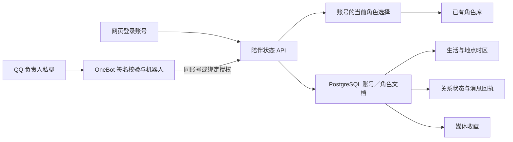

# Web 与 QQ 共享陪伴状态（2026-11-09）

本次按作者要求继续优先完善 AIJADE 情感陪伴产品。11/09 验证时使用本地工作树，本次 Git 归档将对应代码与工程回执一并保存。工程验收不改变学位论文的研究结果或导师确认状态。

## 用户操作

1. 网页和 QQ 机器人连接同一个 AIJADE 服务器。网页登录自己的账号；机器人继续使用其已有的 AIJADE 登录令牌与 OneBot 配置。
2. 在网页“角色”中创建或修改角色，点击“与此角色聊天”。在“陪伴生活”中修改住处、外貌、兴趣、朋友、城市、经纬度、时区与天气开关，然后保存。
3. 如果 QQ 机器人使用另一个 AIJADE 账号，在网页“陪伴生活 → 网页与 QQ 同步”生成绑定码，在配置为负责人账号的 QQ 私聊中发送 `/bind 绑定码`。绑定码十分钟内有效、只能使用一次。绑定消息不进入普通聊天与记忆记录。
4. 保存后，QQ 下一轮自动读取新角色及新设定，无须重启机器人。正在生成的一轮保持其开始时选择的角色；下一轮使用新选择。网页的陪伴生活页每三秒检查共享状态，有未保存修改时保留草稿并提示刷新，不直接覆盖。
5. 网页上传的表情、服装参考图和歌曲录音进入共享收藏。QQ 用图片加 `/sticker joy 名称` 或 `/outfit winter 名称及描述` 添加收藏，网页会自动出现；网页删除后，后续 QQ 发送不再选取该项。`/life`、`/relationship`、`/photo selfie`、`/sing 歌名` 沿用现有命令。
6. 网页点击“解除 QQ 绑定”即撤销该授权。之后 QQ 回到机器人登录账号自己的陪伴状态，不继续读取原网页账号的私有设定。已经发出的内容不会撤回。

城市标签可以先填，天气需要经纬度或城市搜索结果；天气与音色服务继续按已有配置启用。时区填写 IANA 名称，例如 `Asia/Seoul`。留空表示使用服务器返回的共享时区，服务器的 `ROK` 等主机别名会转换成浏览器能识别的 IANA 名称。

## 状态与生效范围

| 内容 | 权威来源 | 修改入口与生效 |
|---|---|---|
| 当前角色、角色卡与人设 | 已有角色库与账号的共享角色选择 | 网页角色编辑、选择；两端新回合重新读取 |
| 虚拟生活、地点、时区与天气偏好 | 账号／角色的服务端文档 | 网页陪伴生活保存；普通回复、生活查询、照片、主动消息和提醒读取对应状态 |
| 好感、关系阶段、情绪与原因 | 服务端依据实际已保存的普通用户消息更新 | Web 与 QQ 交互进入同一状态；同一消息的观察重试只记一次，离线不扣好感 |
| 表情、服装参考、歌声录音 | 同一服务端文档的收藏 | Web 上传／删除，QQ 图片指令添加；媒体按需取得，单项最多 2 MiB、每角色最多 32 项 |
| Web 设置导入／导出、提醒、聊天记录和记忆 | 原有设备／账号存储 | 本轮同步范围不含这些数据。跨账号绑定不合并历史和记忆；机器人聊天仍属于机器人登录账号 |

不同角色的收藏与关系分别保存；切换角色后的新聊天不携带上一角色的会话记录。选择公共角色时，私人关系和收藏仍属于当前账号，并不共享给其他使用该角色的人。

## 实现与并发处理

- 使用既有 `config_kv` 表，不新增数据库迁移。研究模块、已归档实验、冻结的记忆测量路径不变。
- 服务端从登录身份或绑定授权确定资料所属账号，客户端不能通过请求体指定别人的账号。
- 绑定码随机生成，服务端只保留散列和到期时间；授权关联机器人账号和 QQ 身份。重复绑定会撤销原授权，过期、复用和已撤销授权均拒绝。
- 配置保存必须携带读取时的版本号。旧版本返回 `409 COMPANION_CONFLICT`，不能覆盖另一端已保存的新设定。
- 收藏及关系写入使用 PostgreSQL 事务锁，避免并发“读后覆盖”。关系更新要求已落库、属于调用方的用户消息，并为该消息保存独立回执。
- 日常轮询不传全部媒体二进制；页面展示收藏或选中某个媒体后再取实际数据。若选中后该媒体被另一端删除，文字回复仍可继续。
- 旧 IndexedDB 和机器人文件先保留，按来源只复制一次；已有云端配置及关系优先，不覆盖。重复复制不恢复已经删除的收藏。冲突或容量不足会保留旧资料并说明原因。
- 网页首次同步完成前锁定编辑，保存期间锁定按钮；暂时断网后继续重试轮询。角色切换前后的历史、关系与收藏按角色隔离。

## 验收记录

最终验收：117 项单元／集成回归通过、0 失败，6 项可选外部环境用例跳过（Minecraft 5 项，MOSAIC 外部解析器 1 项）；其中新增共享状态服务测试 9 项全部执行并通过。浏览器验收 6 项通过，另有旧聊天／提醒回归 2 项通过，浏览器合计 8 项、0 失败、0 跳过。运行环境为 .NET SDK 10.0.403、PostgreSQL 与 Chromium。原始 TRX、命令、失败轮次与文件散列随交付清单保存。测试源：

- `CompanionSyncTests`：账号隔离、私有角色授权、版本冲突、并发收藏、关系去重、时区共享及主机别名、绑定过期／复用／重绑定／撤销、旧数据复制与机器人读取新选择。
- `CompanionExperienceWebTests`：既有五个生活／媒体／服务配置场景，以及新增的真实浏览器—签名 OneBot 事件完整联调场景。新场景以不同账号完成绑定，验证私有角色、网页改人设与地点时区、QQ 读新提示词、双方关系累计、QQ 收藏回网页、网页删除、两端角色切换、历史隔离及解绑。

浏览器运行真实发布形态的 AIJADE 服务进程、临时 PostgreSQL 和 Chromium；QQ 入站使用真实 HTTP 监听与签名校验，经过生产用解析器、解析共享状态的工厂、聊天编排器、模型网关和消息发送代码。模型输出、NapCat 出站及 QQ 图片源是本地测试替身。这不是实际 QQ 账号／真实 NapCat 联网验收，也不测模型回答质量、情感效果或长期可靠性。

首轮浏览器联调暴露过时区别名和页面初始读取覆盖编辑的问题，另发现切换角色后旧聊天记录未清空。修复后的结果与失败轮次分别保留，不将旧轮次隐藏为通过。没有新参与者、音色训练或第 7 章 C1/C2 研究运行。
