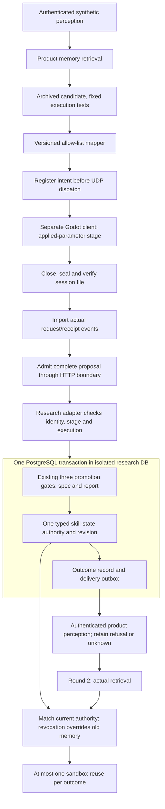

# Chapter 7 staged research adapter

This is a research-only bridge between actual perception/retrieval, the archived
skill sandbox, a versioned allow-listed render mapper, sealed Godot receipts,
proposal admission and promotion. It is hosted by `tests/Aijade.Tests`, not
registered in the companion server. It does not make the product an automatic
learning system.

The [prospective development plan](../plans/2026-11-12-ch7-adapter-qualification.md)
was committed and pushed separately before implementation. Its ten cases qualify
only the C2 path. They do not supply held-out observations, a C1/C2 effect, human
emotion-quality labels, independent replication or hardware qualification.

`PromotionService` retains its original public entry point. Its additional
caller-owned-transaction overload runs the same three gates and allows the
research adapter to roll the spec/report writes back with its state and outbox.
The later HTTP memory write has its own observed status and is not represented as
part of that transaction. An outcome memory never owns a skill's current state.

The map accepts Inform, Comfort and Celebrate only. A successful execution maps
the requested allowed act; failed or unknown execution maps an Inform fallback
but never qualifies promotion. The mapper cannot establish that a valid act fits
the user: the declared S1 counterexample deliberately retains that limitation.

At the implementation commit the development qualification was NOT_RUN. The
[separately archived complete measurement](2026-11-12/README.md) now qualifies
the ten declared C2 development cases and retains the original failed observer
attempt. The held-out C1/C2 batch remains **NOT_RUN**.
