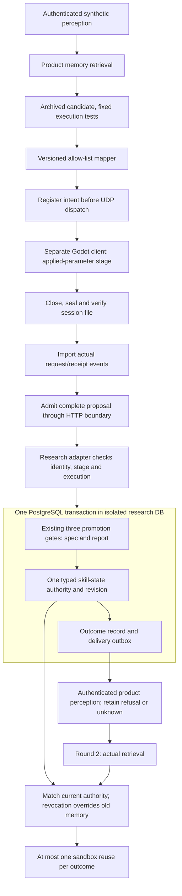
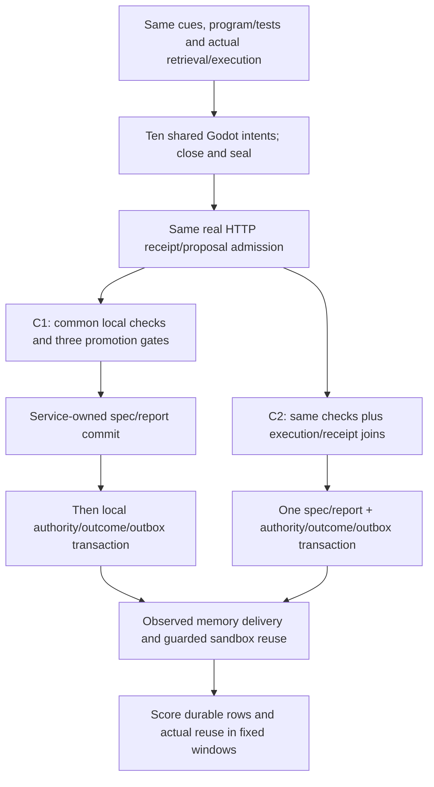
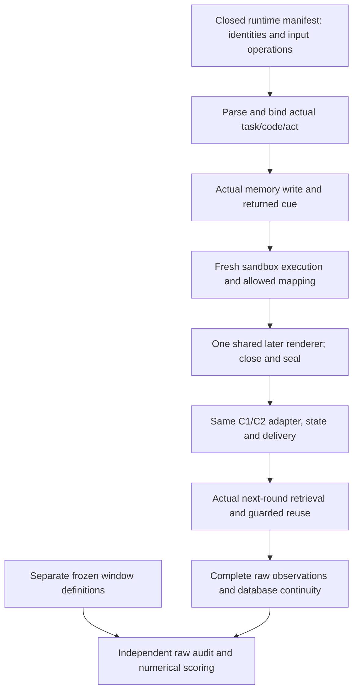

# Chapter 7 staged research adapter

This is a research-only bridge between actual perception/retrieval, the archived
skill sandbox, a versioned allow-listed render mapper, sealed Godot receipts,
proposal admission and promotion. It is hosted by `tests/Aijade.Tests`, not
registered in the companion server. It does not make the product an automatic
learning system.

The [prospective development plan](../plans/2026-11-12-ch7-adapter-qualification.md)
was committed and pushed separately before implementation. Its ten cases qualify
only the C2 path. They do not supply held-out observations, a C1/C2 effect, human
emotion-quality labels, independent replication or hardware qualification.

## Measured chronology

The [chronology audit](CHRONOLOGY-BOUNDARY.md) narrows the accepted batch to
artifact-replay qualification from receipt import/admission through state,
write-back and second-round reuse. Code execution/rendering was prepared before
the per-case initial retrieval; that retrieval did not drive the earlier prefix.
The separately frozen [retrieval-led development batch](retrieval-led-2026-11-12/README.md)
now qualifies the graph below on ten already-known cases. Actual retrieved task,
code hash and requested act select a frozen program before execution/mapping;
the renderer starts afterwards. Each original case database remains alive across
rendering and the import/state/write-back/reuse suffix. Three actual-API cue
changes and five corruptions are independently checked. Original replay
measurements, failed attempts and counters remain unchanged. The new path is
operational development qualification, without a C1/C2 effect or held-out data.

`PromotionService` retains its original public entry point. Its additional
caller-owned-transaction overload runs the same three gates and allows the
research adapter to roll the spec/report writes back with its state and outbox.
The later HTTP memory write has its own observed status and is not represented as
part of that transaction. An outcome memory never owns a skill's current state.

The map accepts Inform, Comfort and Celebrate only. A successful execution maps
the requested allowed act; failed or unknown execution maps an Inform fallback
but never qualifies promotion. The mapper cannot establish that a valid act fits
the user: the declared S1 counterexample deliberately retains that limitation.

At the implementation commit the development qualification was NOT_RUN. The
[separately archived complete measurement](2026-11-12/README.md) now qualifies
the ten declared C2 development cases on that artifact-replay path and retains the original failed observer
attempt. The held-out C1/C2 batch remains **NOT_RUN**.

The later packet retains its own failed initialization attempt (no retrieval or
renderer reached), the separately pushed [narrow amendment](../plans/2026-11-12-ch7-retrieval-led-initialization-amendment.md),
and a fresh complete ten-case run. Its [acceptance record](retrieval-led-20261112.json)
pins all 65 public files, including the manifest. The raw audit reconstructs
chronology, database continuity and both applied-parameter hash conventions.
S1 still admits a semantically wrong allowed act; round-2 reuse executes only the
skill, without another render or generated answer. The later
[paired known-case comparator](paired-development-2026-11-12/README.md) now
qualifies C1 and fixed scoring. A genuinely new held-out batch and its formal
protocol/count approval remain open.

## Strong local baseline and paired development scoring

The [protocol/layout/scoring freeze](../plans/2026-11-12-ch7-paired-development-and-scoring.md)
precedes implementation. C1 preserves admission, execution, all three promotion
gates, idempotency and current revocation; C2 adds cross-module joins and the
shared transaction. Both arms actually retrieve/execute on twenty retained
original databases and share the same ten later-rendered intents/receipt events.
The five C1-first/five C2-first pairs remain known development cases.

There are seven scheduled invalid-promotion and eight integrity-invalid reuse
windows per arm. I3's initial legal actions and I7's pre-revocation promotion are
allowed; absent downstream memory does not shrink a denominator. I8's transient
service success is separate from durable rows. S1 remains a semantic limitation;
round-2 semantic act correctness is **NOT_MEASURED**, since it renders no act.

The [new acceptance record](comparison-20261112.json) pins the complete packet,
including the first local regression timeout and the post-measurement diagnostic
DTO conversion correction. Both failures and their chronology are retained;
primary data, binaries and frozen scores are unchanged, with no measurement rerun.
The finite designed counts qualify mechanisms/scoring, not population effects,
statistical superiority, independent human judgment or formal hardware approval.

## Preparation for genuinely new comparison cases

The [identifier-independent scoring preparation](manifest-preparation-2026-11-12/README.md)
removes the ten development names as required scorer inputs. All twenty original
per-case scores and both condition summaries agree with the frozen scorer after
explicitly labelled aliasing/reordering. Eighteen instrument controls include
adverse C2 results and a reversed contrast; these outcomes are scored, not censored.
Missing observations are unscorable rather than safe zeros. Separate diagnostics
report orphan specs/reports, and the new interface classifies a normal trace with
missing/mislinked records as incomplete; old observed normal results are unchanged.
The source freeze binds 331 actual source/input/dependency files.

This is instrument preparation on existing observations, with zero new empirical
or held-out data. At that stage the live driver was still bound to the development labels.
The [40-pair proposal](heldout-protocol-proposal-v1.json) has no generated cases,
seed, author/supervisor approval or execution. A reviewed manifest-driven live
driver and genuinely new case construction remain necessary before Table 7.3 can
be populated. The [preparation acceptance record](manifest-preparation-acceptance-20261112.json)
and CI check bind the complete derivation and controls.

## Conditional live manifest qualification

The later [live-manifest packet](live-manifest-2026-11-12/README.md) now implements
the operational driver. Closed runtime inputs specify task/code/act and explicit
interventions; case classes, windows and expected results stay outside it. The
driver actually observes both arms and does not require a favorable C2 result.

The first attempt stopped on sustained global swap growth after twenty prefixes,
with no completed suffix; unknown promotion/reuse is not zero. A separately
recorded amendment allowed one fixed 120-second idle admission and one fresh
repeat under unchanged ceilings, binaries and inputs. That conditional repeat
completes twenty case/arm records on the original databases, and reproduces the
earlier finite window counts. Five parser controls, five scoring controls and
seven disposable raw corruptions pass; all forty database leases are cleaned.
The complete [acceptance record](live-manifest-qualification-20261112.json) pins
both attempts and the single admission. No first prefix was reused, no second
render/answer semantics were measured, and no held-out result or formal hardware
qualification is inferred. The 40-pair formal proposal remains unapproved/unrun.
