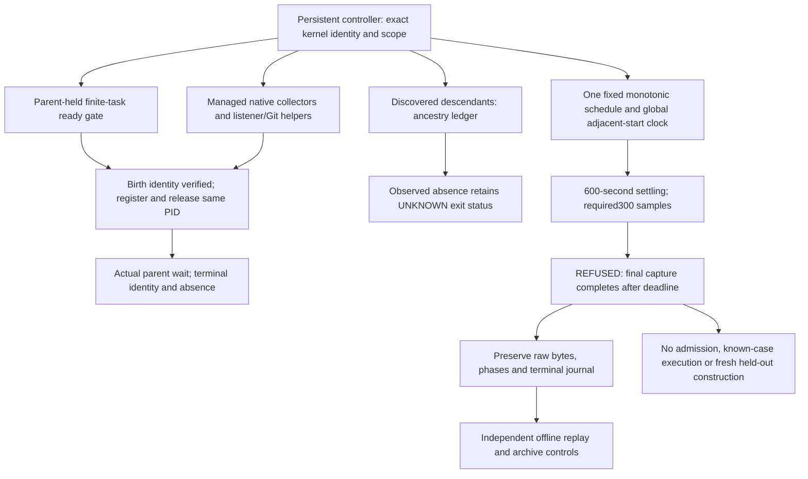

# Typed process lifecycles and the retained fixed-deadline refusal

This archive records one bounded Mac backend decision. It is a terminal-record integrity result, not a successful backend qualification. All earlier refusals and all earlier study populations remain unchanged.

The plan was published alone as **P `9f3a5ead4ca63f489399907fe2e2a8d2aecbab68`** before the implementation. The sole measured implementation is **Q `0c42cc29c64730131466af6b079a900005713cba`**; the binary/dependency/native/prepared-renderer manifests were published as **B `efbcfa0196cbc69bd24cad5b03f01b5078898b7b`** before settling. The packet binds the exact public objects, source bytes, native identities, launch configuration and actual raw clocks.

The actual settling window retains **294 contiguous raw records**, indices0–293, of which **293** finish streaming validation. All294 process/native/API predicates replay PASS. The final sample has nominal start586seconds, actual start598.386783956seconds and completion600.336714976seconds, crossing the fixed600-second completion deadline by0.336714976seconds. Six required final samples were never invoked; no middle records were dropped. Maximum actual adjacent-start gap is2.427652180seconds. Final nominal-grid lateness is12.386783956seconds. Those different clocks and the required300 population cannot substitute for one another.

The journal contains3621 events and1206 finite leases with matching actual parent wait-zero results:588 native collectors,588 listener queries and30 preflight Git tasks. These are engineering identity/cleanup observations. Empty research-owned idle membership and zero owned RSS do not mean that the whole computer used no memory. The separate engineering probe is a short finite-task/discovered-child check, not a qualification phase.

**Admission never starts.** The prepared admission telemetry file is deliberately retained as an empty0-byte artifact. All20 planned known conditions remain **UNATTEMPTED**, with0 UNKNOWN,0 in flight and0 completed. This differs from the preceding bulk attempt's20 UNKNOWN; those earlier dispositions are not rewritten. There is no flow block, renderer session, scientific model request, new held-out case or construction seed. The confirmed40-pair comparison and Table7.3 remain **NOT_RUN**. The19 live-block corruption controls also remain NOT_RUN because no complete live block exists. The bounded decision authorizes no automatic retry or favorable replacement window.

The frozen runtime acceptance API independently returns `ValueError: runtime must have one exact local persistent root` for these idle roots. Its original error, traceback and source SHA are retained. That runtime-domain refusal is not relabelled PASS: idle terminal integrity is separately checked by replaying every original process/native/API sample, journal prefix and lease relationship.

The packet has350 payload files with physical SHA and size for every file; compressed raw files additionally bind exact decompressed bytes and sizes. Original empty files are included. The public audit checks14 observer/runtime sources,331 earlier frozen sources, both older85/71-file refusal packets and the unchanged12352-fact baseline. The12 coherent archive controls each accept their complete original baseline before making an effective mutation and rebinding the whole manifest. The first baseline computes all294 sample predicates; later in-process memoization binds actual complete input/source bytes. These12 archive checks are distinct from the unrun19 live-block controls. Narrow wrapper supplements and all failed archive-tool candidates are recorded separately.

Engineering checks are351 Python controls and684 .NET passes, with67 .NET tests not executed. Their logs and original source candidates, including adverse intermediate failures, remain in the packet. Neither these checks nor later CI qualify the current companion product. Product main retains its own later independent companion implementation; the research executor's exact Q is materialized separately for replay.

The post-stop cost report describes growing full-prefix processing alongside increasing online service cost. It supports a mechanism to investigate, not causal attribution or retrospective acceptance. Any further incremental-prefix repair, equal-load cost check and bounded qualification must have a separate prospective decision. No scientific window is repeated by these offline tools.

See [AUDIT-TOOLS.md](AUDIT-TOOLS.md) for exact CLI/environment requirements and cache boundaries. All interpretation and selected manuscript review remain AI-assisted; no independent human review, formal hardware qualification, author final approval or journal acceptance is implied.

CI materializes exact Q separately and runs the complete terminal baseline before every coherent mutation. The first baseline replays all294 original samples; the in-process cache binds actual bytes. No live Mac observation, qualification or held-out construction occurs.
