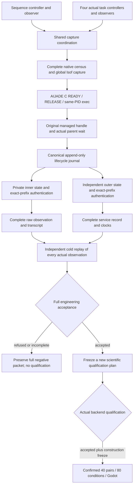

# Native READY observer candidate and retained refusals

This source candidate is an engineering repair, not a qualified backend. Its
[prospective plan](../../plans/2026-11-18-ch7-native-ready-engineering.md),
[protocol](../../plans/2026-11-18-ch7-native-ready-protocol.json) and
[policy](../../../configs/research/ch7-mac-native-ready-engineering-process-policy.json)
require exact-source CI, a separately published passport and complete public
byte verification before one actual engineering window. They cannot create a
fresh Chapter 7 seed or held-out case.

## Actual E6 outcome: refused before nested load

The single frozen window ended with controller exit 1 and an actual enclosing
parent wait, without watchdog expiry or signals. All 168 raw observations were
retained: 167 PASS and one UNKNOWN/REFUSED. There were 167 complete accepted
services, 3,202 finite actual waits returning 0, and 9,609 canonical events.
The final complete service was 2.2452560660021845 seconds, above 2 seconds;
the complete after-listener call was 0.581139005 seconds, above 0.5 seconds.
Its 59-byte stdout still described the expected listener; stderr was empty,
return code was 0 and exception was null. Full transcript timing identifies
deadline rejection; it does not establish a missing port or a unique kernel or
filesystem cause. The two lock-held segments remained below 1.25 seconds.

The independent audit cold-reproduced every one of the 168 raw decisions and
all 336 Native transcripts. Its complete negative inventory is distinct from
the original frozen complete auditor, which actually refused the incomplete
candidate. Inner guard evaluations were 168; outer evaluations were 167, with
no fictitious final outer call. Unknown RSS and four null endpoints remain.
There were 132 unattempted settling slots and 60 unattempted admission slots;
no nested child, model, renderer, qualification, seed or held-out case was run.

See the [complete E6 packet](engineering-attempt-04/packet/) and
[post-terminal portable controls](engineering-attempt-04/post-terminal-controls/).
The [inactive follow-up](../../plans/2026-11-18-ch7-producer-cost-attribution-followup.md)
requires measured producer-cost attribution and another actual source freeze;
it authorizes no window or qualification. The producer did not copy its whole
historical state per lookup. User-space read-byte counters include OS cache and
do not measure device traffic. Its original reaped clock includes a lease read
after Popen.wait, so that interval is not pure lsof/kernel time.

Each private state owns its parser state, hash frontier and mutex. The lock
direction remains shared capture coordination to the Registry's private lock;
caller-provided replay state or predicates are not accepted. Every observation
still runs two native census and two global listener finite tasks. The listener
command is unchanged, without expected-PID filtering or duplicate suppression.
The full external listener frame is limited to 0.5 seconds, complete service to
2 seconds, and each capture-lock wait/held segment to 1.25 seconds.

The first native artifact use in each scope remains the first of its existing
30 Git proof tasks. There is no added warmup, listener exemption, phase reset or
claim of a cold operating system. Original parser, Python shim and independent
cold replay oracle are retained byte for byte; legacy execution is separately
selected by its original policy. Source, binary, current kernel identity,
READY, RELEASE, journal lease and actual wait must agree.

The fixed component probe is **NOT_ALL_PASS**: all 20 alternating operations are
retained; legacy met the complete listener bound in 10/10, native in 9/10. The
first native operation was UNKNOWN at 0.5640400309930556 seconds although its
underlying finite process eventually returned 0. Both histories explicitly
contain 6,308 synthetic prior chains plus ten actual tasks; they do not establish
actual nested load, full 15.5 MiB coverage, or cold-start acceptance.

Previous adverse windows remain available in full:

- [E3 first-service refusal](../nested-load-2026-11-17/engineering-attempt-01/packet/).
- [E4 late service refusal](../nested-copy-2026-11-18/engineering-attempt-02/packet/).
- [E5 complete negative packet](../owned-state-2026-11-18/engineering-attempt-03/packet/),
  [normal portable verifier and post-terminal controls](../owned-state-2026-11-18/engineering-attempt-03/post-terminal-controls/).

E5 retained 174 raw observations: 173 PASS and one UNKNOWN, with 173 streaming
PASS and one REFUSED. All 174 complete service clocks met two seconds; the last
was 1.4176597030018456 seconds. The final coarse listener UNKNOWN has no unique
identified OR cause. Only 173 outer evaluations actually occurred; the final
UNKNOWN cannot be retrospectively promoted or given a fictitious outer call.
No nested child, admission window, qualification or held-out case was reached.

Table 7.3 stays `NOT_RUN` until the separate scientific gates are actually met.
Unit controls, source review, CI, GitHub/SVN delivery and transport verification
do not supply engineering acceptance, human review or hardware certification.
