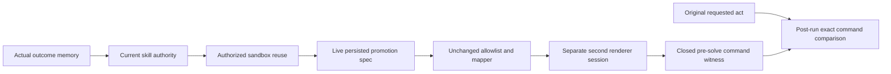

# Known-case second-round persisted-act command observations

The prospective plan was pushed alone at c2f2011, then the additive implementation
was committed and pushed before its clean build and single fixed idle admission.
The original complete live packet, its stopped first attempt and all earlier
policies, mappings and numerical facts remain unchanged.

The new run uses the same ten constructed cases and 20 condition trajectories.
After actual authority-guarded second sandbox reuse, the bridge reads the stored
promotion specification from the original live database. Its allow-listed act,
not the original requested act or an expected outcome, drives a separately
registered second-session command for each executable condition. No new semantic
gate, permission or model answer is added.

data-summary.json and the full raw audit report every scheduled disposition,
refused reuse, unavailable configuration, sent command, known/missing witness
and match/mismatch denominator per condition. Missing rendering is unknown,
never a correct act or zero error. The nine disposable corruptions rebind the
preparation handoff and relevant journal captures before checking cross-source
inconsistencies; primary bytes are preserved.

Command agreement is narrower than semantic appropriateness: observed consumed
commands and the animation hint support the behavior_overlay_pre_solve stage.
They do not prove presented pixels, emotional naturalness, human benefit,
generated-answer quality, a new fault population, independent human review or
formal Mac eligibility. The same-researcher renderer is not independent-team
replication. Full held-out protocol/count/backend review and new cases remain open.

attempts/development-01 contains the entire decision-relevant root and both
renderer-session records. Logical raw-file hashes are preserved under lossless
gzip. Unused PMX/geometry/vertex exports remain local by hash; no model is
redistributed. engineering records the clean build, all regression results,
binary/source identity, the first raw audit and terminal resource/cleanup state.
The plan authorizes exactly one admission window and at most one attempt,
without resource-limit relaxation, retry or prefix merging.
