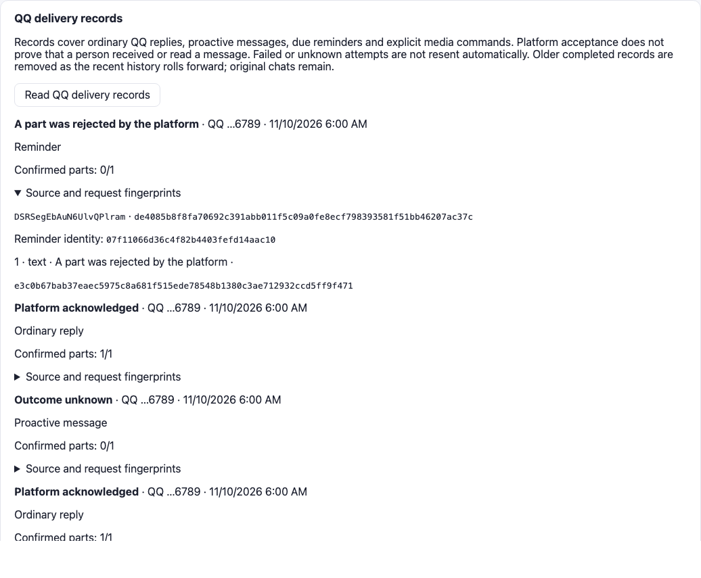

# 主动消息与提醒的来源关联交付

起点为 `a7b1aad4c026c3515ef876831952d3a1acb90dd1`。本轮延续共享运行时，把 QQ 主动开口和到期提醒接入普通回复所用的交付记录；旧文本接口和其他连接器的文本发送回退保留。没有增加宿主、后台服务、.NET 项目、NuGet 包或数据库迁移。具体命令、源码／二进制指纹、原始 TRX、计数和跳过清单见 [receipt.json](receipt.json)。

`FirstRepliesAsync` 和 `DueReminderReplyAsync` 保留已存助手消息的身份；`ConnectorHost` 经 `IProactiveConnector.SendReplyAsync` 交给现有 QQ 发送器。服务端从实际来源元数据确定普通回复、主动消息或提醒类型，以及提醒触发 ID，客户端不提交这些分类字段。网页按账号／角色读取同一份记录，类型与交付状态分别显示。原有夜间、冷却、安静请求和频率门控继续适用。

提醒簿的 `done` 仍表示提醒文本已经保存，和平台接受分开。文本生成失败会释放认领；已存提醒被平台拒绝或结果未知时，不重新生成。如果进程停在文本存储与本地提醒文件更新之间，下一次检查按同一聊天中的提醒 ID 复用原消息；其交付尝试仍在保留窗口内时，连接器不再发请求。恢复测试通过还原生成前的提醒文件来触发这条路径，分别覆盖接受、拒绝和未知三种既有结果。

实际验证包括：

Release 构建 0 警告、0 错误。UTC 单元／集成 567 通过、15 跳过；定向 50/50 通过；完整配置浏览器 32 通过、6 个授权 MMD 环境项跳过；精简配置专项 11/11 通过。最终套件均无失败。原始 TRX 列出每个跳过项，真实模型、Minecraft、渲染环境及选跑研究装置不被计为通过。

- 普通回复与主动开口经过生产 bridge、来源存储、平台发送器和同一交付 API，保留各自消息身份。
- 三种到期提醒回执、生成失败后释放、再次检查不增加模型请求或平台发送，以及还原提醒文件后复用已存来源。
- 原有提醒契约、夜间与安静请求门控、发送故障、来源／授权和运行时边界回归。
- 签名 OneBot HTTP 入站、实际服务／PostgreSQL／Chromium 中的普通回复回执、主动消息未知、提醒拒绝及重载后的来源类型和触发 ID。调度时钟注入推进，无需等待真实十分钟。

这些记录由获授权的 relay 上报；平台接受不等于收件人收到或已读，也不是独立外部证据。原有最多 128 次尝试、每次 64 片段、未结束记录 10 分钟投影未知的限制保留。没有永久 exactly-once、入站事件去重、持久 outbox 或失败后的自动补发；聊天删除、角色切换或尝试淘汰后的重复不在这次恢复保证内。网页和机器人日程仍分别保存在各自渠道，其他平台未获得本轮 QQ 交付记录能力。

受保护清单包含起点已有的 644 个研究、既有工程证据、共同基础和声明测量文件；本轮逐字节核对。论文由原 Python 3.9.6 解释器重算的 9,878 项事实与修改前完全一致。没有新增模型性能运行、训练或主研究样本；模型与 NapCat 出站均为受控夹具。P2-R-Mac、P3-E 和第 7 章保留集比较仍按原研究账本分别验收。

开发失败也保留：新增测试初次编译涉及资料保存接口参数、修订字段名及 CA1859；浏览器首轮在 Web 初次导入完成前修改资料，被正常的修订冲突保护拒绝。最终夹具等待“陪伴生活”页完成初始化，并使用当前角色及资料修订号；没有移除产品并发保护。对应原始日志与失败 TRX、修正后及最终回归分别归档。
