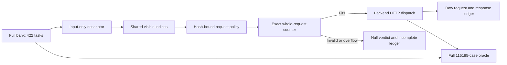

# Bounded input exposure and exact request budgets

Plan 9036bce was separately pushed before implementation. This stage addresses the long full-input verifier prompts observed at d43a102. It preserves the 422-task, 115,185-case bank, execution comparisons and historical 44-task behavior. It supplies no new model-reliability observations, author task approval or device qualification.

The opt-in `--request-policy FILE` binds a presentation-only exposure profile, exact model/template identities, context and stage-specific reply caps to a local tokenizer adapter. The model request is checked before dispatch. An overflow, counter failure, invalid reply or length-limited response stops the attempt with a null verdict and a separate incomplete receipt; it cannot produce an accepted primary summary. Request and response text, count identities and process identity are retained. The original full task always reaches the execution sandbox.

The selector receives a C# input-only descriptor. It examines cases in source order, displays at most three and uses the same selection for both models/templates. A case must have at most 512 raw tokens in both models, and both actual empty-candidate chat prompts must leave the fixed candidate allowance and 256 verification reply tokens. Scenarios are compact4k (4,096 context / 2,048 generation allowance) and compact8k (8,192 / 4,096). Zero-visible tasks remain in the population. Their eventual eligibility is pending author review. The bounded prompts explicitly describe partial visibility and retain original case indices. This notice is a wording change, so capacity comparisons with the historical full-input prompts are descriptive; a later reliability comparison requires a wording-matched design.

`prepare_configs.py` reuses the exact local models, templates, source files, native helper and tokenizers 0.22.1 installation from the preceding stage. It records hashes and never downloads weights or starts model inference. `run_preparation.py` first checks that the full historical raw-prompt export is byte-identical, repeats all 30 model/control combinations, selects the fixed population, and measures all 8,440 profile/model rows plus every unique input/tentative query used to make selections. All four raw/chat/special-token views are compared by native and independent engines; complete ID/decoded-byte streams are retained. Controls, selection and each model's complete pass have explicit process-family limits and fail as whole attempts. The old immutable tokenizer archive is not rewritten.

The actual C# dispatch boundary is exercised through `p2-budget-check` with a synthetic in-process HTTP handler. It uses the real local counter and includes fitting/overflowing generation, A/B verification, long retries, exact token boundaries and one-token excesses, malformed counter replies, changed identities and response failures. Special-token markers create exact-length fixtures; they are not realistic generated skills. The normal RQ-C mock control checks policy fingerprints and prefix continuation without launching a tokenizer or model. Neither control is a model result.

All primary choices remain open: task/domain review, development/selection split, difficulty/precision pilots, candidate diversity, N/q/T and qualified live Mac runs. This stage's source and complete records are separately identified. Do not treat configured policy files, passing controls, offline token counts or green CI as scientific acceptance.

## Accepted preparation and retained failures

The complete accepted attempt is `records/attempt-04`, executed at `2bcb47f65baee6779ad62c536f2167448213a2c8` after the original plan and two prospective engineering amendments. Its source CI is https://github.com/korose523/AIJADE/actions/runs/42975147409. `results/summary.json` separates the frozen execution source from this later evidence archive.

| Recorded quantity | Accepted result |
|---|---:|
| Full execution population | 422 tasks / 115,185 cases, unchanged |
| Displayed / undisplayed rows, each scenario | 1,266 / 113,919 |
| Profile forms / model rows / token views | 4,220 / 8,440 / 33,760 |
| Unique selection queries / separate token views | 4,361 / 34,888 |
| Model/control combinations | 30 |
| Actual-counter, synthetic-HTTP fixtures | 72; 12 exact-boundary pairs |
| Reference-backed mock steps / replayed prefix steps | 96 / 64 |
| Identity/input rejections before output | 8 |
| New model completion calls | 0 |

Both fixed policies select the first three original inputs in every task. Six displayed rows repeat argument bytes; the original case weights are retained. Before the three-input ceiling, no real task exercises an input-length or planning-budget rejection. This finite outcome does not validate adaptive selection on other populations. All full execution cases remain in the original bank.

| Scenario | Generation cap | Verification cap | Empty-probe joint fit | Reference-probe joint fit |
|---|---:|---:|---:|---:|
| 4,096 context | 2,048 | 256 | 422/422 | 0/422 |
| 8,192 context | 4,096 | 256 | 422/422 | 422/422 |

Joint fit requires initial generation and both A/B verifiers to fit for both models. Reference ports include compatibility helpers; neither those ports nor the empty functions are generated model candidates or bounds on future code. Real requests are counted in full before dispatch. The 72 fixtures produce 40 synthetic HTTP dispatches, 24 overflow rejections, eight counter failures and four each of length, verdict-format and HTTP failures. Failed fixtures retain null verdicts and incomplete receipts.

Attempt 01 retained complete agreeing tokenizer substages but failed the overall rule on process-family memory, uncaught counter identity and an all-pass mock assertion that had incorrectly retained pCorrect=0.5. The first amendment fixed exception receipts and pCorrect=1, but its effective 768 MiB managed-heap setting caused attempt 02 to stop in the legacy export. The minimal runtime diagnostic and a separate development probe are retained. The second amendment removed that cap and bounded unreachable allocations between artificial guard fixtures only. Attempt 03 passed tokenizer/guard controls and full mock/resume decisions, but a CLI identity rejection aborted instead of returning the prescribed error code. The CLI error handler was repaired under the existing rejection rule; attempt 04 then repeated the entire preparation and passed. No measurement prefixes are merged. `records/development-lifecycle-qwen` and `records/development-cli-repair` are separate development checks, outside the accepted denominators.

The CPU/wall/RSS/physical-file ceilings remain unchanged. Exact exposure bytes and complete token-stream logical hashes agree across the completed tokenizer substages. All three rejected complete attempts remain rejected, including their unfavorable receipts. Repeated scenarios and attempts are not independent empirical observations.

The recorded HTTP handler is synthetic. The production guard is opt-in through `--request-policy`; historical defaults and the complete historical prompt export remain unchanged. The bounded notice and the historical A/B questions still require a common full-task judgment target before a model pilot. Partial visibility is not an independent held-out or contamination-free benchmark. Author task/domain review, live model/device checks, difficulty/precision pilots and primary N/q/T remain pending.

## Model-free archive audit

Run `python3 experiments/p2-a/bounded-input/2026-11-11/verify_archive.py` from a complete checkout. It uses only the standard library and retained data, not model weights, the tokenizer runtime or a model service. It independently rebuilds all prompt bytes and choices, joins complete native/independent ID and decoded-byte streams, recomputes every capacity task set and checks the actual guard, mock and resume receipts. Corrupted IDs/counts/hashes, missing rows, changed templates/systems, indices/input identities, query counts/bytes and missing input tasks receive negative controls.

`records/transcode-index.json` records original physical hashes, lossless logical hashes and stored hashes/sizes. Gzip token streams and large JSON/JSONL/log payloads are losslessly stored as XZ; readers resolve the compressed filenames. Paths in captured runtime configurations are original observations. Reconstruct fresh local configurations with `prepare_configs.py`; do not reuse relocated absolute paths as live settings. Weights and the full vocabulary are not redistributed here.
