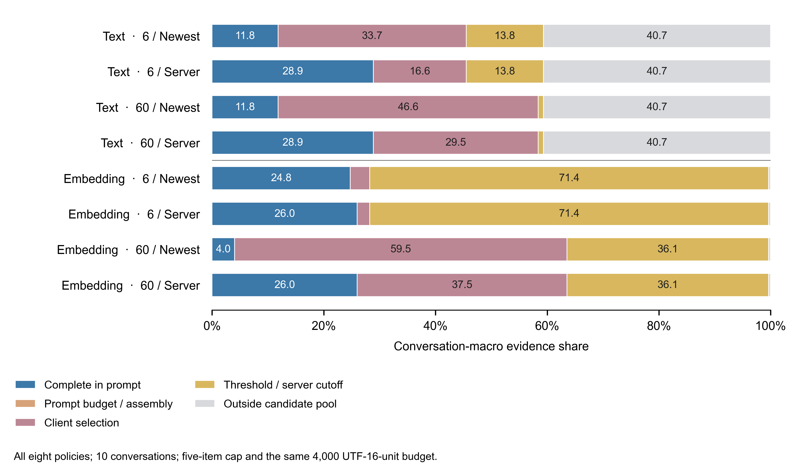

# P3: complete configured policy comparisons, 10 November 2026

All 16 declared cells completed all 10 LoCoMo conversations and 1,986 questions per cell. There are 31,776 actual completion-request captures. The primary population is the 1,540 answerable questions: four without annotated evidence are excluded from the recall denominator, leaving 1,536; unlocated gold evidence on nine questions remains in that denominator. All-question and located-evidence sensitivity views are in `summary.json`.

The result is conditional on this corpus, fixed vector replay, named write/read configurations and the common prompt boundary. It does not evaluate answer accuracy, default LLM fact extraction, a complete external agent, full Web/QQ interaction, proactive messages or Chapter 7's held-out chain. Qualitative interpretation is AI-assisted, without recorded independent human coding. No supervisor receipt, scientific acceptance or submission approval is inferred.

## Prospective records and accepted execution identities

| Record | Commit | Timing and scope |
|---|---|---|
| [Original plan](../../plans/2026-11-10-p3-full-policy-comparison.md) | `132bfda51b95fd4b0ebfc23304142d56bfcb455b` | Separately pushed before instrumentation; previous product results already known |
| [Native scalar-recording amendment](../../plans/2026-11-10-p3-policy-recording-amendment.md) | `87e2f3189ad3eb7fdabd4e45ae298cf8d84b78e2` | Pushed before repair after the zero-row external serialization failure |
| [Auxiliary entity-vector amendment](../../plans/2026-11-10-p3-entity-vector-amendment.md) | `2b1bf563c945618aa1ef8a85efbf642e265fd374` | Pushed before code and supplemental local embedding preparation |
| Product execution | `fd4fb3045711ab9061d12ea65e659c9f0ff2b100` | Complete `runs/attempt-01/{text,embedding}` |
| External execution | `1c78bf920902a6aeff6b4b269b9883d1c120a983` | Fresh complete `runs/attempt-03` |

These are two complete study parts, with separate recorded source and binary identities. No question rows were merged between attempts. `receipt.json` binds them individually; `execution.json` preserves their complete phase records. The 974 previously existing runtime/configuration/research files in `protected-inputs.json` remain byte-identical. No production selection policy was deployed on these results.

## Product: from candidate pool to actual prompt

Each retrieval mode crosses response limit 6/60 with five-newest/response-union order. The final cap is always five items and the memory-module budget always 4,000 UTF-16 units. A captured request, rather than an expected pre-budget list, establishes complete-item presence. Server order means first appearance in merged responses, including term priority and per-term recency for text fallback; it is not a global semantic ordering for text. The four cells share an immutable ingested conversation store and rotate execution order. No question is written back.

Numbers below are conversation-macro evidence fractions: average question fractions within each conversation, then average the ten conversation means. Loss is an absolute recall difference, not a fraction of the initial loss. Full paired intervals and all stages are retained in `summary.json`.

| Mode / response limit / final order | Candidate-pool recall | Server response recall | Actual complete-prompt recall [95% interval] | Pool to prompt loss |
|---|---:|---:|---:|---:|
| Text / 6 / newest | 0.593162 | 0.455166 | 0.118183 [0.091040, 0.144293] | 0.474979 |
| Text / 6 / server | 0.593162 | 0.455166 | 0.288890 [0.258120, 0.316827] | 0.304272 |
| Text / 60 / newest | 0.593162 | 0.583787 | 0.118183 [0.091040, 0.144293] | 0.474979 |
| Text / 60 / server | 0.593162 | 0.583787 | 0.288890 [0.258120, 0.316827] | 0.304272 |
| Embedding / 6 / newest | 0.996227 | 0.282259 | 0.247552 [0.188207, 0.312842] | 0.748675 |
| Embedding / 6 / server | 0.996227 | 0.282259 | 0.259945 [0.196606, 0.331186] | 0.736282 |
| Embedding / 60 / newest | 0.996227 | 0.635223 | 0.040392 [0.030227, 0.051131] | 0.955835 |
| Embedding / 60 / server | 0.996227 | 0.635223 | 0.259945 [0.196606, 0.331186] | 0.736282 |

Widening the embedding response recovers evidence at the server, but newest-five selection then discards more of it: client loss rises from 0.034707 to 0.594831. Under response order, widening changes neither mode's first-five result. Text's smaller pool-to-prompt loss partly reflects its lower initial pool coverage; it is not evidence of higher final recall than embedding. No additional assembly loss, source ambiguity or partial item was observed in this corpus. Synthetic long/Unicode fixtures retain the separate possibility of budget loss.

At limit 6, response-order minus newest recall is +0.170707 for text (Holm p=0.01171875) and +0.012393 for embedding (Holm p=0.15625). The response-limit/order interaction is 0 for text and +0.207160 for embedding (Holm p=0.01171875). These are the six predeclared product contrasts, with separate paired intervals and exact sign-flip p-values in the summary. The small embedding contrast at limit 6 is not declared significant after the prespecified correction.



Editable SVG, TrueType PDF, source CSV, plotting script, provenance, glyph audit and collision audit are included. The plot stacks actual prompt recall, assembly loss, client loss, server threshold/cutoff loss and evidence outside the pool; uncertainty is in the paired result tables, not marginal error bars on stacked segments.

## External native write/read: signed effects and D

LangChain's pinned time-weighted retriever runs actual `add_documents`/`invoke` with FAISS, decay 0.01, 100 semantic candidates, eight recent candidates and k=8. Access refresh ON/OFF uses separate trajectories and restores native pre-read access metadata only in OFF. Corpus times shift by a fixed conversation offset and questions advance the prescribed clock by one minute. Relevance-only changes the final scorer without replacing candidate generation.

Mem0's pinned `Memory.add(infer=False)`/`search` uses local Qdrant, one turn/item, rerank OFF and top_k=60; native code over-fetches 240 semantic candidates. The policy switch is semantic threshold 0.1/0.0; the relevance-only adapter removes BM25/entity contributions only at final scoring. The unsupported creation-time argument is omitted: native write clocks remain, while source times are preserved in metadata. This does not run default model-driven fact/entity extraction. Each trajectory contains 5,882 source items across ten stores (median 109 UTF-16 units, quartiles 73/161, maximum 454; one source turn each).

External effects use conversation-macro **hit-any recall@8**, distinct from evidence-fraction recall in the actual five-item prompt. All first-five external outputs traverse the same shared prompt assembler and are actually captured.

| Configuration | Own minus relevance, policy ON | Policy ON minus OFF, own scorer | D [95% paired interval] |
|---|---:|---:|---:|
| LangChain / access refresh | −0.313748 [−0.399158, −0.239060] | −0.000706 [−0.006599, 0.004751] | 0.313042 [0.236006, 0.396921] |
| Mem0 turn storage / threshold | +0.259940 [0.201427, 0.310905] | 0 [0, 0] | 0.259940 [0.201427, 0.310905] |

`D = abs(macro scoring effect) - abs(macro policy effect)`, recomputed inside each paired resample; it is not a mean of absolute per-conversation effects. Its intervals are descriptive. Scoring effects have opposite signs, and both D intervals lie above zero only for these named configurations. The two scoring exact p-values are 0.001953125 (Holm 0.0078125); policy p-values are 0.875/1 (Holm 1/1).

All external cells also retain evidence-fraction stage values, distinct from the hit-any statistic above:

| System / policy / scorer | Pool evidence recall | Delivered-eight evidence recall | Actual-five prompt evidence recall |
|---|---:|---:|---:|
| LangChain / ON / own | 0.747498 | 0.034866 | 0.027163 |
| LangChain / ON / relevance | 0.747498 | 0.317726 | 0.259945 |
| LangChain / OFF / own | 0.747498 | 0.034470 | 0.023592 |
| LangChain / OFF / relevance | 0.747498 | 0.317726 | 0.259945 |
| Mem0 / ON / own | 0.942860 | 0.551594 | 0.468630 |
| Mem0 / ON / relevance | 0.942860 | 0.317726 | 0.259945 |
| Mem0 / OFF / own | 0.942860 | 0.551594 | 0.468630 |
| Mem0 / OFF / relevance | 0.942860 | 0.317726 | 0.259945 |

These systems construct different pools; this is not a system-quality ranking. All 16 cells' stages, loss differences and intervals are additionally exported as `policy-stage-data.csv`. There was no additional assembly loss in these external captures either.

Access refresh changes 1,940 ordered top-eight outputs but only 22 gold counts across all 1,986 questions, so a small net recall effect does not mean no policy activity. Mem0's threshold changes zero candidate masks and zero top-eight outputs; its observed entity collection is empty under `infer=False`, although the complete native entity lookup branch executes. This inactive cutoff is not evidence that broader maintenance policies have no effect. LangChain has 601 read rows with exact eighth-boundary ties across its 7,944 reads; native stable order is preserved without a favorable tie rule. Mem0 has no eighth-boundary ties.

## Vector provenance, failures and model-call accounting

Original document/question inputs use the unchanged preceding P3-E vector journal (SHA-256 `a2598df6ea738c59e807c7baff2be216c1290c38b483e3cbe7ee29b309d2b1f9`). Native Mem0 auxiliary entity lookup needs 735 previously uncaptured strings. After the coverage amendment, 12 real local embedding HTTP calls prepared those inputs once with the same `nomic-embed-text` manifest digest `0a109f422b47e3a30ba2b10eca18548e944e8a23073ee3f3e947efcf3c45e59f`. `entity-preparation/` retains coverage, actual responses, supplemental f32 vectors and independent equality verification. The temporary model server was stopped after preparation. No model was downloaded and no paid service was used.

The **study setup adds 12 embedding calls**; the policy replays add zero live model calls. Chat, answer and judge model calls are zero throughout this follow-up. Fixed local completion responses establish the request boundary, not response quality.

The first external attempt failed serializing `numpy.float32` on its first question, leaving zero durable question rows. The repair converts recording fields to builtin floats but returns the native scalar unchanged, preserving native arithmetic and ranking. Attempt 02's LangChain run completed; Mem0's 7,944 rows were all rejected because its library caught native entity-vector replay misses and logged degraded branches. They are excluded from every primary estimate. Both external implementations restarted fresh in attempt 03 after complete coverage; neither old LangChain rows nor degraded Mem0 rows were merged into it. Earlier build warnings, the wrong-dotnet-host test failure, their corrected runs, native warnings and all excluded outputs are retained, rather than selecting a favorable result.

## Statistical conventions and verification

The paired conversation bootstrap uses 10,000 common resamples, seed 20261110, `randrange` sampling and linearly interpolated percentile endpoints. Exact two-sided sign-flip tests enumerate all 1,024 signs, with Holm correction over the six product or four external signed contrasts separately. Previous P3-E used `choices` and order-statistic endpoints; its baseline point estimates match exactly, while its old intervals remain unchanged. Existing 9,980 manuscript facts are unchanged; 633 new values use `p3pol.*`.

Seven consequential analysis checks cover unknown bounds, conversation weighting, partial Unicode items, source ambiguity, duplicate rows, exact sign flips and the absolute-macro definition of D. Independent NumPy search recomputation validates all actual product response boundaries, including term searches; no boundary tie changes the results. Native source files are cross-checked against pinned official repositories, and package versions and licenses are retained. Raw-copy re-analysis, missing/duplicate/corrupt-capture rejection and receipt/hash rejection checks are separate from scientific interpretation.

The exact product execution's local suite passed 583, skipped 17, failed zero; its exact GitHub CI `42812936801` passed 578, skipped 22. Release rebuild and six external qualification cases passed for the accepted external execution. Browser cases not enabled in CI are not called passed. CI and engineering tests establish their specified checks; they are not independent replication, whole-product validation or research approval.

## Re-analysis

From this directory, with Python 3.9+ and no live service:

```sh
gzip -dc corpus-export.json.gz > /tmp/aijade-policy-corpus.json
python3 analyze.py runs/attempt-01 --external-folder runs/attempt-03 --entity-supplement entity-preparation/supplement.json.gz --corpus /tmp/aijade-policy-corpus.json --out /tmp/aijade-policy-summary.json
python3 -m unittest -v test_analyze.py
```

From the repository root:

```sh
python3 tools/audit_advisor_evidence.py --policy-receipt experiments/p3-policy/2026-11-10/receipt.json --require-current-version --out /tmp/aijade-policy-audit.json
```

`analyze.py` and its `transport.py` helper are standard-library-only. Native replay execution additionally uses the pinned external distributions and .NET build recorded in the receipts; it is a new execution, not required to verify the archived statistics. Raw capture files are gzip-compressed without deleting question rows. The two Mem0 files exceed GitHub's single-file limit, so their original compressed bytes are published as 60-MiB chunks with `.parts.json` manifests. The reader verifies every chunk and the original whole-file digest before streaming them. There is no recompression or record change, and the original local files remain retained. Two additional transport checks verify exact round-trip bytes and rejection before exposing records when one chunk is corrupted (`python3 -m unittest -v test_transport.py`). The included LoCoMo export is third-party public corpus data, under the accompanying unmodified `LOCOMO-LICENSE.txt`; it is neither private user chat nor newly recruited participant data. Implementation licenses remain with their installed packages. See the repository's third-party notices.
